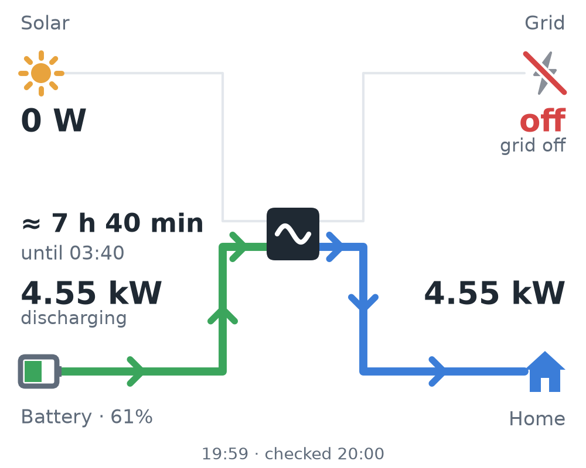
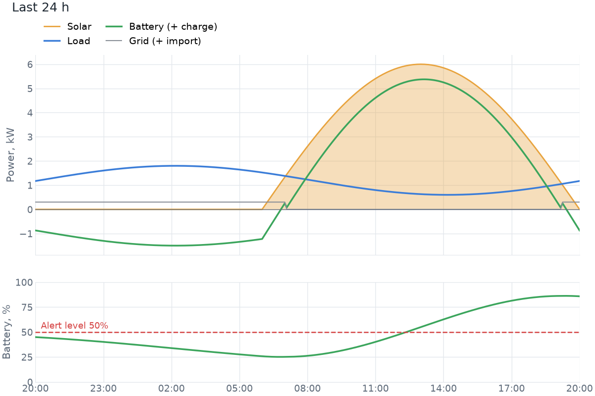
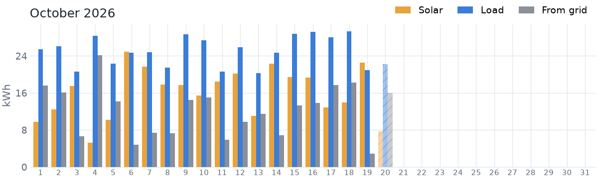

# vydpobot

Telegram bot for building vital stats. First module:
monitors a Deye hybrid inverter (tested design target: three-phase LV
SUN-xK-SG04LP3) through the Solarman Cloud OpenAPI. It runs in Docker on a small VPS.

<p>
  
  
</p>
<p>
  
  
</p>

## Features

- `/status`: a power-flow diagram (solar, grid, battery, home, with flow direction and power)
  and a text summary caption with a 10-cell battery SOC bar.
- Battery alerts: a message when SOC falls to a threshold (default 50 %) and at every further
  step (45 %, 40 %, ...), a "recovered" message once SOC climbs back above the threshold plus a
  hysteresis. Oscillation around a level does not spam.
- Stale-data and outage detection: warns when the logger stops reporting, or when polling fails
  three times in a row, and tells you when it is back.
- `/graph [hours]`: chart of PV, load, battery, grid and SOC (1..48 h, default 24) with an
  energy summary.
- `/month [YYYY-MM]`: grouped daily bars (solar, consumption, from grid) and monthly totals with
  the self-sufficiency percentage; a report of the previous month is posted automatically on the
  1st (OpenAPI backend). See "Monthly statistics".
- A monthly rollover: the old live message becomes the monthly report and a new live message is
  pinned. See "Fresh live message each month".
- Runtime threshold and language (English / Ukrainian) changes, persisted in SQLite.
- 14 days of local samples are kept so charts still work if the cloud history call fails.

## Solarman Cloud API access

The bot reads your inverter through the **Solarman OpenAPI** — the same cloud the Solarman
Smart app uses. The Wi-Fi logger stick on the Deye uploads data to Solarman (by default every
~5 minutes); the bot then reads it from the cloud, so it can run anywhere (VPS) without any
access to your home network.

### 1. Check your Solarman account

- You must be able to log in to the Solarman Smart app / [home.solarmanpv.com](https://home.solarmanpv.com)
  with **email + password**. If you signed up with a phone number or a Google/Apple login, add
  an email and set a password in the account settings first — the API only accepts
  email + password.
- The plant (station) must show your inverter and live values (PV, battery, load) in the app.
  If the app shows nothing, the bot will show nothing either.
- International accounts live on `globalapi.solarmanpv.com` (the default). Accounts on the
  Chinese platform use `https://api.solarmanpv.com` — set `SOLARMAN_BASE_URL` accordingly.

> **Note:** if your plant was moved to the **Deye Cloud** app and no longer appears in Solarman
> Smart, this API won't see it. Deye Cloud has its own developer portal
> (developer.deyecloud.com); a Deye Cloud backend could be added to the bot later.

### 2. Request API credentials (appId + appSecret)

See **[SOLARMAN_API_ACCESS.md](SOLARMAN_API_ACCESS.md)**: the official process, free-plan limits,
and an email template that includes the required Developer Agreement statement.

### 3. Optional: a dedicated read-only account

The bot logs in with an email and password. To keep your main password out of the server,
you can create a second Solarman account and share the plant with it from the app (plant →
settings → sharing / members, read-only/visitor role if your app version offers it). Then
use that account's credentials in `.env`. If plant sharing isn't available in your app
version, use your main account. The bot only ever calls read endpoints.

### 4. Fill in `.env` and find your IDs

```env
SOLARMAN_APP_ID=2023xxxxxxxx
SOLARMAN_APP_SECRET=xxxxxxxxxxxxxxxxxxxxxxxxxxxxxxxx
SOLARMAN_EMAIL=you@example.com
SOLARMAN_PASSWORD=your-plain-password     # hashed (SHA-256) by the bot before sending
# or, instead of the plain password:
# SOLARMAN_PASSWORD_SHA256=<64 lowercase hex chars>
```

Prefer `SOLARMAN_PASSWORD_SHA256` so the plain password never sits in `.env`. The bot checks the
format at startup (64 hex characters) and refuses to start if both are set. Compute the hash locally (the password is typed at a hidden prompt, not stored in shell history,
and never sent anywhere):

```bash
uv run --no-project python -c "import getpass, hashlib; print(hashlib.sha256(getpass.getpass().encode()).hexdigest())"
```

Avoid `echo password | shasum`: `echo` adds a newline, which produces a different (wrong) hash.
Online SHA-256 tools work too, but they mean typing your password into a third-party website.

`discover` and `dump` need a complete `.env`; the Telegram values can be dummies such as
`TELEGRAM_TOKEN=0:x`, `ALERT_CHAT_ID=0` when you only want to check Solarman.
List the plants and devices visible to the account:

```bash
uv run vydpobot discover                      # local dev
docker compose exec vydpobot vydpobot discover  # on the server (bot running)
```

Copy the station `id` into `SOLARMAN_STATION_ID`. Copy the `deviceSn` of the device with type
**INVERTER** (not COLLECTOR — that's the Wi-Fi stick) into `SOLARMAN_DEVICE_SN`. With several
parallel inverters use the **master** inverter's SN. The SN is used **only for grid status**
(grid voltage and frequency, to tell a real outage from an idle grid). Device values are one
inverter's share, so they are never mixed into the plant totals (power, load, SOC).

### 5. Verify battery and grid sign conventions

Verified on real OpenAPI data (2026-10-10), `station/realTime`:

- `purchasePower` is the grid **import**, `gridPower` the **export** (null when not exporting),
  and `wirePower` only the grid-line magnitude (never subtracted). So
  `grid_w = purchasePower - gridPower`.
- Solarman reports **negative** battery power while **charging**, in both `batteryPower` and
  `chargePower`. So `battery_w = -batteryPower` (or `abs(chargePower) - abs(dischargePower)`
  when `batteryPower` is absent).
- The 5-minute history items are assumed to use the same convention; check with
  `vydpobot dump --history`, which prints one history item.

The bot normalizes to: `battery_w > 0` = charging, `battery_w < 0` = discharging,
`grid_w > 0` = importing, `grid_w < 0` = exporting. Solarman data differs between setups, so
check once. Run `vydpobot dump` **in the daytime while the battery is clearly charging** (SOC
rising in the app):

```bash
uv run vydpobot dump
uv run vydpobot dump --station-id 123456 --device-sn 2401012345   # include device-level data
```

At the bottom is the normalized snapshot. `battery_w` must be **positive** while charging and
`battery_state` must read `charging`. If it's the other way round, set
`SOLARMAN_INVERT_BATTERY_SIGN=true`. Do the same for the grid: `grid_w` is positive when
importing from the grid (check in the evening with no PV). If it's reversed, set
`SOLARMAN_INVERT_GRID_SIGN=true`. Re-run `dump` to confirm.

The raw `dataList` section of the dump also shows every key your inverter reports, and the
detected `grid_state`. If grid status comes back empty, compare those keys with `GRID_KEYS` in
`src/vydpobot/solarman/client.py` and adjust. The bot logs each new `ST_PG1` (Grid Status) text
once at INFO, so the wording used during an outage can be learned.

### 6. Limits and freshness

- Data is only as fresh as the logger's upload, about 5 minutes. Polling faster gains nothing,
  and the API has per-app call quotas. `POLL_INTERVAL_S` is 300 by default, with a minimum of 120.
- Tokens are valid for about 60 days. The bot fetches and refreshes them automatically.
- Several wrong-password logins in a row can temporarily lock the account. After a rejected
  login the bot backs off (5 min, doubling per consecutive failure, capped at 1 h) and logs a
  warning. If you see it, stop the bot, check `SOLARMAN_EMAIL`, `SOLARMAN_PASSWORD` and the
  appId/secret (log in to the web portal to verify), then restart.
- If the logger loses Wi-Fi, the cloud data freezes. The bot then posts a "no fresh data" alert
  after `STALE_AFTER_MIN` minutes and a "back online" message when uploads resume.

## Temporary: web-portal backend (unofficial)

Until the official OpenAPI keys arrive (or if you never get them), the bot can read the same
data through the **Solarman web portal** (home.solarmanpv.com) API that the website itself uses.
Select it with `SOLARMAN_BACKEND=portal`; the default stays `openapi`.

**Risks, read first:**

- It is an **undocumented, private API**. It can change or break at any time without notice.
- Using it is **likely against Solarman's terms of service**. Use it at your own risk.
- Use a **test account only** (a second Solarman account that has the plant shared with it),
  never your main account. If Solarman blocks the account, you lose nothing important.

### How it authenticates

Password login on the portal is protected by a slider CAPTCHA, so a script cannot log in. Instead
you log in once in a browser and give the bot the **refresh token** from the login response. The bot
exchanges it for short-lived access tokens. Each exchange **rotates** the refresh token; the bot
saves the new one in its SQLite database right away. The token you put in `.env` is only the
starting value: the rotated one in the database wins, until you put a *different* token in `.env`.

### Capturing the token

The refresh token is visible in the JSON response of the login request (on at least the
`FOREIGN_1` region there is no refresh-token cookie unless "Remember me" is ticked).

1. Open a **private/incognito window** at [home.solarmanpv.com](https://home.solarmanpv.com).
   Open DevTools (**F12**) **before** logging in: **Network** tab, tick **Preserve log**, and
   type `token` in the filter.
2. Log in with the **test account** (solve the slider).
3. Click the `oauth2-s/oauth/token` request, then **Response**. The JSON contains
   `access_token`, `refresh_token`, `expires_in` (86399), `mdc` and more. Copy the value of
   **`refresh_token`** (the long `eyJ...` string; its payload has an `ati` claim and it is valid
   for about 6 months). Do **not** take `access_token`: it expires in 24 hours.
4. **Close the window without logging out.** Do not click "Log out": the refresh token is
   rotated by the bot from now on, and logging out may revoke the token on the server. Also do not
   keep using that browser session, because a second client renewing the same token would
   invalidate the bot's.
5. **Never paste the token into chats.** Put it into `.env` on the server, or send it with
   `/token <value>` in a private chat with the bot (the bot deletes the message).

Alternative: a refresh-token cookie
`442287045fabeaa868450dec4baee7f4` appears when **"Remember me"** is ticked at login, so the cookie
method works then too (on some regions it may exist anyway) (DevTools -> Application -> Cookies). It is HttpOnly,
so `document.cookie` cannot see it; copy its value by hand (it may be URL-encoded).

### Configuration

```env
SOLARMAN_BACKEND=portal
SOLARMAN_PORTAL_REFRESH_TOKEN=<the refresh_token value>
# Optional, only if your region needs it (sent as `area` when renewing the token):
# SOLARMAN_PORTAL_AREA=PL
# Optional, default https://home.solarmanpv.com (some regions: https://globalhome.solarmanpv.com):
# SOLARMAN_PORTAL_BASE_URL=https://home.solarmanpv.com
```

The OpenAPI settings are not needed in this mode. `SOLARMAN_DEVICE_SN` is ignored (the bot logs a
warning), because device-level data is not available through the portal, so the grid state
stays unknown and outages are inferred from the power flows. `discover` and `dump`
work with both backends. They must share the bot's database, so on the server run them with
`docker compose exec vydpobot vydpobot …`, not with a different `DB_PATH`.

Measured battery power comes from the portal's Flow Chart endpoint (`fast/system`), one request
per poll. Only if that request fails (or lacks battery data) does the bot fall back to the station
summary and estimate battery power from the energy balance (PV + grid − load), marked with "≈"
everywhere it is shown. Expect the estimate to run typically 5–10% above the true value because of
inverter losses.

### When the token stops working

If the portal rejects the token, the bot stops calling the portal and sends **one** message to
the admins (private chats of `ADMIN_USER_IDS`, or `ALERT_CHAT_ID` if none are set) with the
capture steps. Repeat the steps above, then send the new value to the bot **in a private chat**:

```
/token <value>
```

The command is hidden (not in the command menu), admin-only and private-chat-only. The bot deletes
your message immediately, checks the token by renewing it, saves it, and never echoes it back.

### Probing for the 24 h history endpoint

The portal's 5-minute history endpoint is not known yet, so `/graph` currently uses the samples
the bot has stored locally (14 days are kept, so charts fill up over time after you start it).
To help implement the real endpoint, run the read-only probe and share its output with the
maintainer:

```bash
uv run vydpobot portal-probe --out probe.json     # or: docker compose exec vydpobot vydpobot portal-probe
```

It renews the token, lists stations and devices, fetches the station details and tries the
candidate history URLs. All tokens are scrubbed from the output, but skim it before sharing: it
contains your station and device details.

### OpenAPI quota note

The free OpenAPI tier for Smart accounts allows at most 3 plants and 200 000 calls per year
(about 548 per day). Every HTTP request counts, token requests included.

| Call | Cadence | Calls/day |
| --- | --- | --- |
| Station realtime | `POLL_INTERVAL_S` = 5 min | 288 |
| Device grid status (`SOLARMAN_DEVICE_SN`), on demand | only while the grid shows no flow, at most every 5 min | 0 normally, up to +1 per poll |
| Balance check | once per local day | 1 |
| **Total** | | **about 289/day normally, about 105k/year of 200k** |

- Device polling is **on demand** by default (`DEVICE_POLL_S=0`). The device call (grid voltage)
  is made only when the station snapshot shows the grid with no flow (|grid| < 50 W), whatever
  the battery is doing, so a sunny outage is checked too. While the grid flows it is evidently
  online and no call is made. Set `DEVICE_POLL_S` to 300 or more for the old periodic polling
  (for example 600 = 144 calls/day extra).
- Once per local day the bot asks Solarman for the real number of calls left on the account
  (`/account/v1.0/balance`, one call; OpenAPI backend only) and logs
  `Solarman API calls remaining: N`. If N covers fewer than 30 days at the current rate
  (on-demand: 288/day plus 10%), the admins get one notice that day. The last known value is
  also shown in the 90% daily-budget notice. `vydpobot dump` prints it too.
- `/status` and `/live` use no API calls: they show the latest poll result (or the newest stored
  sample after a restart).
- `/month` and the monthly report: 1 call for a month of up to 30 days, 2 for a 31-day month, only
  when the month is not cached. A month that has ended is cached forever; the current month is
  refetched at most once an hour. At 100% of the daily budget the cached data is used (or an
  error is shown when there is none).
- `/graph` uses the stored samples first, when they cover the requested window (oldest sample
  within 15 min of the start, no gap over 30 min). Otherwise it fetches the API history once and
  stores those points, so later charts need no API call.
- In periodic mode, an outage suspicion (grid idle while the battery discharges) refreshes the
  device data at once, at most every 5 min.
- The bot counts requests per local day (stored in the database). At 90% of
  `SOLARMAN_DAILY_BUDGET` (default 548) the admins get one notice per day; at 100% it skips
  device polls and history fetches, but never the realtime poll. The daily total is logged at
  INFO when the day rolls over, and the expected daily calls are logged at startup (in on-demand mode
  the warning looks at the realtime base only).

## Telegram setup

1. Open [@BotFather](https://t.me/BotFather), send `/newbot` and pick a name and username
   (or `/mybots` -> your bot -> *API Token* if it already exists). Copy the token into
   `TELEGRAM_TOKEN`. The token alone identifies the bot; the username is not configured
   anywhere in the code.
2. Open a chat with your new bot and press Start (a bot cannot message you first).
   To receive alerts in a group or channel, add the bot to it first; in a channel the bot
   must be an administrator (with permission to post messages).
3. Optional: in BotFather, `/setprivacy` -> Disable if you want the bot to see all messages in
   a group. Commands (`/status@your_bot`) work in groups even with privacy mode enabled, so this
   is usually not needed.

### Chat and user IDs

- Your user ID: message [@userinfobot](https://t.me/userinfobot). For a private alert chat,
  `ALERT_CHAT_ID` is your user ID.
- Group ID (easiest): start the bot, add it to the group and send `/status@your_bot` there.
  The bot ignores the unknown chat and logs
  `Ignored command from chat_id=-100… (supergroup 'Your group')`. Put that number in
  `ALERT_CHAT_ID` and restart. Group IDs are negative; supergroups look like `-100…`.
  Changing some group settings converts a group into a supergroup and **changes its ID**. If
  alerts stop arriving, repeat this step.
  Alternative: stop the bot, then open `https://api.telegram.org/bot<TOKEN>/getUpdates` and read
  `message.chat.id` (`getUpdates` conflicts with a running bot).
- Set `ADMIN_USER_IDS` to the user IDs allowed to change settings (`/threshold <n>`,
  `/lang <en|uk>`). Anyone in `ALERT_CHAT_ID` or `ALLOWED_CHAT_IDS` can use `/status`,
  `/graph`, and view settings.

## Configuration

```bash
cp .env.example .env   # then edit; every variable is documented inside
```

`REARM_HYSTERESIS_PCT` (default 5) has a minimum of 2: SOC must rise this many points above
the threshold before the alert cycle resets (SOC readings jitter by about 1 %).

## Dry run before deploying

```bash
uv run vydpobot preview [--out DIR] [--lang en|uk] [--hours N] [--no-graph] [--no-equipment] [--no-month]
```

Runs one full bot cycle on your machine and shows what the bot would do, without Telegram:

- **Prints** (HTML stripped, emojis kept): the normalized snapshot with `grid_online` and the
  voltages, the `/status` text, the pinned live caption with its length against the 1024
  limit, the alerts that would be sent (or `none`), the `/health` text, the runtime context
  (outage, estimate, battery capacity used and whether it is configured or learned) and the
  Solarman API calls used.
- **Writes** to `--out` (default `./preview`): `status_flow.png`, `live_flow.png`,
  `graph_{hours}h.png` (`--hours` 1..48, default 24), `month_{YYYY-MM}.png` (the current month,
  with a MONTH section in the text; skipped with a note on the portal backend or with
  `--no-month`) and `report.txt` (the same text as the
  terminal). The absolute paths are listed at the end.

A failing step (for example healthchecks.io being down) is shown as an error in its section and
the rest still runs. The exit code is 0 if the Solarman poll succeeded, 1 if it failed.

Cost: 1 to 3 Solarman API calls (the realtime call, a device call when the grid shows no flow,
and the history call of the graph when the local samples do not cover the window; skip it with
`--no-graph`; the monthly statistics add 1 to 2 calls for an uncached month, skip them with
`--no-month`). It sends nothing to Telegram and works on a temporary copy of `DB_PATH` (with its
`-wal`/`-shm` files), which is deleted afterwards. The one exception is the portal backend: its
refresh token is single-use, so if the preview renews it, the new token (and only that) is written
back to the real database. Otherwise the bot would be left with a dead token.

## Local development

Requires [uv](https://docs.astral.sh/uv/). The project uses its own `.venv`.

```bash
uv sync                          # creates .venv with dev dependencies
uv run vydpobot run              # start the bot
uv run pytest -q
uv run ruff check src tests && uv run ruff format --check src tests
```

If another virtualenv is active in your shell, prefix commands with `env -u VIRTUAL_ENV`.

## Docker deployment (production)

The bot runs as a long-lived container: `docker compose up -d` starts it in the background, and
`restart: unless-stopped` brings it back after a crash or a server reboot. All state (alert
state, `/threshold` and `/lang` overrides, live-message IDs, the rotated portal token, and
stored samples) lives in `./data` on the host, so it survives restarts, rebuilds, and updates.

### First deployment (VPS)

1. Install Docker Engine with the compose plugin, and make Docker start on boot:
   ```bash
   sudo systemctl enable --now docker
   ```
2. Get the code and configure it:
   ```bash
   git clone <this repo> vydpobot && cd vydpobot
   cp .env.example .env && chmod 600 .env && $EDITOR .env
   mkdir -p data && sudo chown 10001:10001 data   # the container runs as non-root uid 10001
   ```
3. **Stop any other running copy of the bot** (for example `uv run vydpobot run` on your
   laptop). Telegram allows only one poller per token, otherwise both fail with `Conflict`.
4. Portal backend only: the refresh token rotates, so a token that another machine already
   used is dead. Either capture a fresh one for the server (see
   [Capturing the token](#capturing-the-token)), or stop the local bot and copy its database,
   which holds the current rotated token:
   ```bash
   scp data/vydpobot.sqlite3 vps:vydpobot/data/ && ssh vps 'sudo chown 10001:10001 vydpobot/data/*'
   ```
5. Start it and check it:
   ```bash
   docker compose up -d --build
   docker compose ps                  # STATUS should be "Up"
   docker compose logs -f vydpobot   # Ctrl+C stops following, the bot keeps running
   ```

### Upgrading from `deye-bot` / `vydpo-bot`

The project was renamed: the package and CLI are now `vydpobot`, and so are the compose service and
container. The database is `data/vydpobot.sqlite3`. Because the compose **service name changed**,
stop the old container first, otherwise it keeps running next to the new one (two bots on one token
fail with `Conflict` and fight over the portal token):

```bash
docker compose down            # with the OLD compose.yaml, before pulling
git pull
docker compose up -d --build --remove-orphans
```

On first start the bot renames an existing `data/vydpo_bot.sqlite3` or `data/deye_bot.sqlite3`
(with its WAL and lock files) to the new name, so the portal token, settings, equipment state and
the pinned live message carry over. An existing `vydpobot.sqlite3` is never overwritten.

### Admin commands against the running bot

Run them **inside** the running container, so they share its database and token:

```bash
docker compose exec vydpobot vydpobot discover
docker compose exec vydpobot vydpobot dump
docker compose exec vydpobot vydpobot portal-probe
```

(If the bot is stopped, use `docker compose run --rm vydpobot vydpobot …` instead: it starts a
temporary container that is removed afterwards.)

### Day-to-day operations

| Task | Command |
|---|---|
| Follow logs | `docker compose logs -f --tail 100 vydpobot` |
| Restart (e.g. after editing `.env`) | `docker compose up -d` (re-reads `.env`; `restart` alone does not) |
| Update to a new version | `git pull && docker compose up -d --build` |
| Stop temporarily | `docker compose stop` (stays stopped, even after a reboot, until `docker compose start`) |
| Remove the container | `docker compose down` (`./data` is kept; `up -d` recreates it) |

Logs are rotated (3 × 10 MB).

### Backups

`./data/vydpobot.sqlite3` is the only state worth backing up. In portal mode it also holds the
live refresh token, so treat backups as secrets. A consistent copy while the bot is running:

```bash
docker compose exec vydpobot python -c "import sqlite3; s=sqlite3.connect('/app/data/vydpobot.sqlite3'); d=sqlite3.connect('/app/data/backup.sqlite3'); s.backup(d)"
```

## Bot commands

| Command | Who | Description |
| --- | --- | --- |
| `/start`, `/help` | allowed chats | Show help |
| `/status` | allowed chats | Live power flow and battery state |
| `/graph [hours]` | allowed chats | Chart for the last 1..48 hours (default 24) |
| `/month [YYYY-MM]` | allowed chats | Daily bars and totals for a month (default: this month; OpenAPI only) |
| `/threshold` | allowed chats | Show current alert threshold and step |
| `/threshold <5..100>` | admins | Set threshold (persisted; resets the alert cycle) |
| `/lang` | allowed chats | Show current language |
| `/lang <en\|uk>` | admins | Switch language (persisted) |
| `/live` | admins | Start or refresh the pinned live-status message |
| `/live off` | admins | Remove the live-status message |
| `/health` | allowed chats | State of the building equipment monitored via healthchecks.io |
| `/token <value>` | admins, private chat | Portal backend only, hidden: supply a new refresh token |

Access: read-only commands work in `ALERT_CHAT_ID`, `ALLOWED_CHAT_IDS`, and in private chats
with admins. Others get a "not allowed" reply in private chats and are ignored in groups.

## Live status (pinned message)

A single message in the group that always shows the current status: the power-flow picture plus
a caption. The bot edits it on every poll, so it never needs a new `/status`.

- `/live` (admin): creates the message, pins it silently and starts updating it. Running it again
  just refreshes the existing message. The `/live` command itself is deleted to keep the chat clean.
- `/live off` (admin): unpins and deletes the message and stops updating it.
- Works in the alert group and in other allowed chats; each chat has its own live message.
- With building-equipment monitoring on, the caption also lists every monitored check with its
  status (see "Building equipment" below).

**Permission.** To pin, the bot needs one right in the group: Edit -> Administrators -> Add
Admin -> your bot, and enable ONLY "Pin Messages". Without it the bot still keeps the message
updated, just not pinned (it tells you so).

**Notifications.** Edits are silent. Alerts stay separate notifying messages.

**No extra API calls.** The picture is refreshed from the data already fetched by the regular
poll (or the last stored sample if a poll fails, so the "updated ... ago" text and the stale
warning keep aging). `/lang` and `/threshold` changes show up immediately.

The first caption line is what Telegram shows in the pinned bar:
`🔋 47% +3.2 · ☀️ 5.1 · 🏠 2.0 · 🔌 0.1 kW · 10:35`

| Part | Meaning |
| --- | --- |
| `🔋 47% +3.2` | Battery charge, and battery power in kW: `+` charging, `−` discharging, `0.0` idle |
| `☀️ 5.1` | Solar generation, kW |
| `🏠 2.0` | Home consumption, kW |
| `🔌 0.1` | Grid, kW: no sign = buying (import), `−` = selling (export) |
| `10:35` | Time of the reading (`dd.mm HH:MM` if not from today); `⚠️` in front means stale data |

`—` stands for a missing value.

## Fresh live message each month

The bot edits the pinned live message in place. An edit does not show as a new message in the
chat. The bot sends a new live message only in these two cases:

1. **Once a month (the monthly rollover).** On the 1st at `MONTHLY_REPORT_TIME` (default 09:00):
   1. The bot edits the old live message in the alert chat into the report of the past month
      (chart and totals). The old message showed that month, so it becomes its archive.
   2. The bot sends a new live message, pins it and unpins the old one.

   The new live message is then the last message in the chat. Over time, the chat history has one
   report for each month and the current pinned status at the bottom.
2. **When a user deletes the live message.** The next refresh cannot edit the message. The bot
   then sends a new live message and pins it.

The bot sends the new message and the pin silently (`disable_notification`). The report edit also
does not send a notification.

- The edit has no age limit, so the 48-hour delete limit of Telegram does not apply.
- If there is no live message in the alert chat, or the edit fails, the bot posts the report as a
  new message. Then it replaces the live message.
- If the report fails, the bot tries again after 30 minutes. It changes nothing before the report.
- With the portal backend (no monthly data), the bot only replaces the live message.
- If `MONTHLY_REPORT_TIME` is empty, there is no monthly report and no monthly rollover.
- If the bot is down on the 1st at that time, it does the rollover after the start on the same day.
- Live messages in other chats (from `/live`) get a new live message. The old one is deleted if
  possible, else unpinned.
- Every pin adds a "bot pinned a photo" service notice to the group. Give the bot the **Delete
  messages** admin right (together with "Pin Messages") to let it remove its own notices.

## Monthly statistics

`/month` (allowed chats) shows grouped daily bars for solar generation, home consumption and
energy bought from the grid, plus a caption with the totals. `/month 2026-09` shows another
month; future months are rejected. Today's bars are drawn lighter and hatched because the day is
not finished.

```
📅 October 2026 (1–10)
☀️ Solar: 382.7 kWh
🏠 Consumption: 712.1 kWh
🔌 From grid: 312.0 kWh
🔋 Self-sufficiency: 56%
```

The range `(1–10)` appears only for the current month; "To grid" only if the export is above 0.
Self-sufficiency is `1 − from grid / consumption`, limited to 0..100%.

- Data: the OpenAPI daily history (`timeType 2`, kWh per day). It needs `SOLARMAN_BACKEND=openapi`;
  the portal backend answers that the statistics are unavailable.
- Quota: 1 request for a month of up to 30 days, 2 for a 31-day month (the API allows 30 days
  per request), only when the month is not cached. Results are cached in the database; a month that
  has ended (and was fetched after the day following its end) is final and never fetched again,
  the current month is refetched when older than an hour.
- Automatic report: on the 1st of each month at `MONTHLY_REPORT_TIME` (default `09:00`) the
  previous month is posted to `ALERT_CHAT_ID`. The posted month is stored, so a restart never
  posts it twice; if the bot was down at that time, it posts after the next start on the same
  day. A failed attempt is retried every 30 minutes that day. Set `MONTHLY_REPORT_TIME=` (empty)
  to disable it.

## Battery runtime during outages

When the grid goes down, the bot estimates how long the battery will keep the house running.

- **Detection (and its limitation).** The cloud API has no "grid off" flag, so an outage is
  inferred: the battery is discharging while the grid line is idle (|grid| < 50 W), on two
  consecutive polls (this avoids flapping on a single odd sample). Limitation: a house that is
  on the grid but runs from the battery with zero grid exchange looks the same. For the portal
  backend the first detected outage logs the raw `wireStatus` at INFO, so the real "grid off"
  word can be learned from the logs later.
- **Shutdown level.** The inverter cuts the home supply at a fixed SOC. That setting cannot be
  read through the cloud, so it is configured: `BATTERY_SHUTDOWN_SOC` (default 10).
- **Capacity.** `BATTERY_CAPACITY_KWH` sets the usable capacity. If unset, it is learned from the
  last 14 days of stored samples: clean charge or discharge stretches (at least 200 W, SOC moving
  3 points or more) give energy / SOC change, and the median is used (recomputed at most hourly,
  logged at INFO when it changes by more than 5%). Until enough history exists, the estimate falls
  back to the SOC slope over the outage so far (needs 20 min and a 1-point drop).
- **Averaging window.** The discharge power is averaged over the on-battery samples of the last
  `RUNTIME_WINDOW_MIN` minutes (default 120); with less than 15 minutes of data the current power is
  used. Estimates above 72 h show as "> 72 h". The end time is rounded to 10 minutes.
- **Where it appears.** The `/status` and live captions get a line such as
  `⏳ Battery lasts ≈ 5 h 20 min (until ~23:40)` and the grid line reads "Grid: off (running on
  battery)". The pinned summary line ends with `· ⏳ 23:40`. The power-flow picture shows "grid
  off" and "discharging · until ~23:40". `/graph` draws a dashed SOC projection down to a
  "10% shutdown" line with the end time (the axis extends at most 12 h ahead).

No extra Solarman calls are made: only the current snapshot and the stored samples are used.

## Building equipment (healthchecks.io)

The bot can also watch your other building equipment (internet, cameras, lift and so on) that
you already monitor with [healthchecks.io](https://healthchecks.io). It polls the Healthchecks
Management API for the checks you list and posts status changes to the alert chat. (This is
unrelated to the inverter, and the bot does not ping healthchecks.io itself.)

**1. Create a read-only API key.** In healthchecks.io open your project: Project Settings ->
API Access -> "Create API keys" -> choose the read-only key.

**2. Find the check identifiers.** Each check can be listed by its slug (shown under the check's
name, or in the check details -> Settings), by its name (any letter case, Cyrillic and spaces
are fine), by its unique key (what a read-only key exposes) or by its UUID.

**3. Configure `.env`** (both the key and the list are needed; with only one set the bot logs a
warning and stays off):

```
HEALTHCHECKS_API_KEY=your-read-only-key
HEALTHCHECKS_CHECKS=internet, cameras, lift
# optional: HEALTHCHECKS_POLL_S=300 (min 60), HEALTHCHECKS_API_URL=https://healthchecks.io
```

**Alert semantics.**
- A check going `down` gives one alert: `🔴 Lift is down (last signal 12:35)`. When it is `up`
  again: `🟢 Lift is back up (was down 2 hours)`.
- Grace, started, paused and new states never alert. down -> grace -> up still counts as one
  recovery.
- State is stored in the database, so a restart does not repeat an alert for a check that is
  still down. Names that match no check are only logged as a warning.
- If the API is unreachable three times in a row, the admins get one notice (nothing when it
  recovers).

**`/health`** lists every configured entry with its status (🟢 up, 🟡 grace, 🔴 down, ⏸ paused,
🆕 new, ▶️ started, ❓ not found), the last ping time and when it was checked.

**Pinned live message.** When monitoring is on, the caption gets an equipment section above the
"Data" line: a `🩺 Equipment` header and one line per configured entry in `HEALTHCHECKS_CHECKS`
order (status emoji and name). A down check also shows the time of its last signal (`🔴 Lift -
down since 12:35`, with the date if not today); an unknown entry shows `❓ name - not found`.
If the section would push the caption over Telegram's 1024-character limit, down checks are kept
first, the rest follow in order, and the end reads `... +N`; if even one line does not fit, the
old one-line summary (`🩺 3/4 OK · 🔴 Lift`) is used instead. The live message is refreshed on the
first successful check after a start and whenever any check changes status (not on every ping),
as well as right after an equipment alert, using stored data only.

Keep Healthchecks' own notifications (email, Telegram, ...) switched on as a backup: they still
reach you when the bot or the server it runs on is down.
