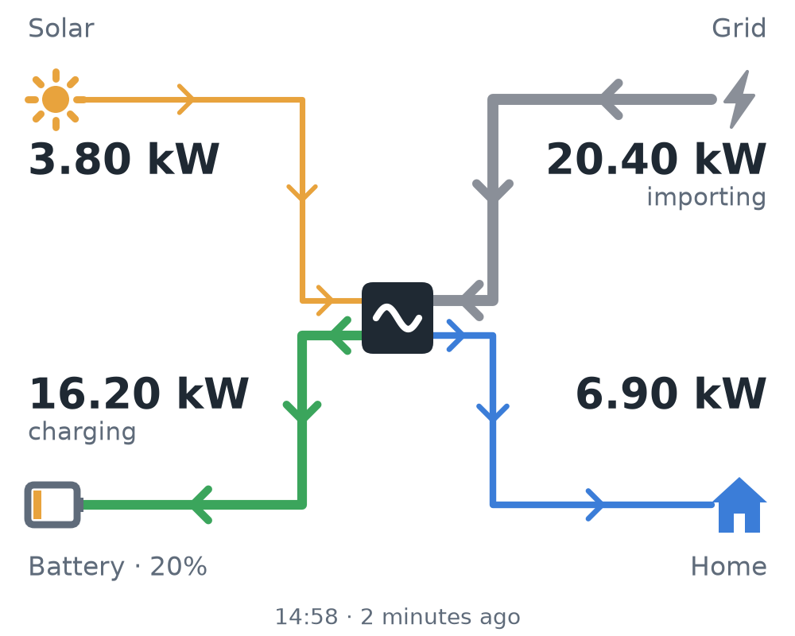
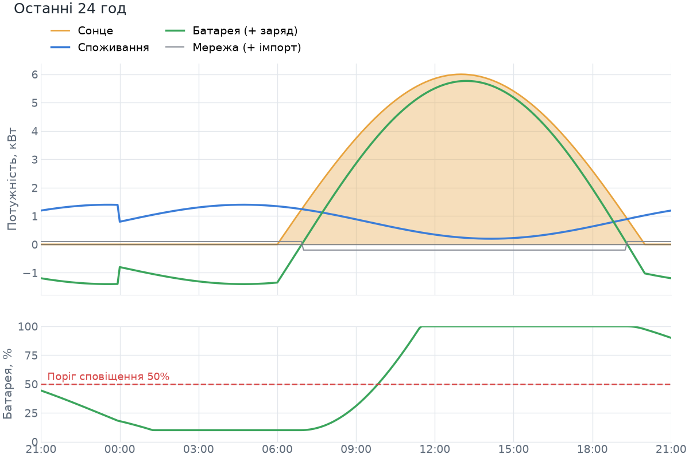

# vydpo_bot

[@vydpo_bot](https://t.me/vydpo_bot) — Telegram bot for building vital stats. First module:
monitors a Deye hybrid inverter (tested design target: three-phase LV
SUN-xK-SG04LP3) through the Solarman Cloud OpenAPI. It runs in Docker on a small VPS.

<p>
  
  
</p>

## Features

- `/status`: a power-flow diagram (solar, grid, battery, home, with flow direction and power)
  and a text summary caption with a 10-cell battery SOC bar.
- Battery alerts: a message when SOC falls to a threshold (default 50 %) and at every further
  step (45 %, 40 %, ...), a "recovered" message once SOC climbs back above the threshold plus a
  hysteresis. Oscillation around a level does not spam.
- Stale-data and outage detection: warns when the logger stops reporting, or when polling fails
  three times in a row, and tells you when it is back.
- `/graph [hours]`: chart of PV, load, battery, grid and SOC (1..48 h, default 24) with an
  energy summary.
- Runtime threshold and language (English / Ukrainian) changes, persisted in SQLite.
- 14 days of local samples are kept so charts still work if the cloud history call fails.

## Solarman Cloud API access

The bot reads your inverter through the **Solarman OpenAPI** — the same cloud the Solarman
Smart app uses. The Wi-Fi logger stick on the Deye uploads data to Solarman (by default every
~5 minutes); the bot then reads it from the cloud, so it can run anywhere (VPS) without any
access to your home network.

### 1. Check your Solarman account

- You must be able to log in to the Solarman Smart app / [home.solarmanpv.com](https://home.solarmanpv.com)
  with **email + password**. If you signed up with a phone number or a Google/Apple login, add
  an email and set a password in the account settings first — the API only accepts
  email + password.
- The plant (station) must show your inverter and live values (PV, battery, load) in the app.
  If the app shows nothing, the bot will show nothing either.
- International accounts live on `globalapi.solarmanpv.com` (the default). Accounts on the
  Chinese platform use `https://api.solarmanpv.com` — set `SOLARMAN_BASE_URL` accordingly.

> **Note:** if your plant was moved to the **Deye Cloud** app and no longer appears in Solarman
> Smart, this API won't see it. Deye Cloud has its own developer portal
> (developer.deyecloud.com); a Deye Cloud backend could be added to the bot later.

### 2. Request API credentials (appId + appSecret)

See **[SOLARMAN_API_ACCESS.md](SOLARMAN_API_ACCESS.md)**: the official process, free-plan limits,
and an email template that includes the required Developer Agreement statement.

### 3. Optional: a dedicated read-only account

The bot logs in with an email and password. To keep your main password out of the server,
you can create a second Solarman account and share the plant with it from the app (plant →
settings → sharing / members, read-only/visitor role if your app version offers it). Then
use that account's credentials in `.env`. If plant sharing isn't available in your app
version, use your main account. The bot only ever calls read endpoints.

### 4. Fill in `.env` and find your IDs

```env
SOLARMAN_APP_ID=2023xxxxxxxx
SOLARMAN_APP_SECRET=xxxxxxxxxxxxxxxxxxxxxxxxxxxxxxxx
SOLARMAN_EMAIL=you@example.com
SOLARMAN_PASSWORD=your-plain-password     # hashed (SHA-256) by the bot before sending
```

`discover` and `dump` need a complete `.env`; the Telegram values can be dummies such as
`TELEGRAM_TOKEN=0:x`, `ALERT_CHAT_ID=0` when you only want to check Solarman.
List the plants and devices visible to the account:

```bash
uv run deye-bot discover                      # local dev
docker compose run --rm vydpo-bot deye-bot discover  # on the server
```

Copy the station `id` into `SOLARMAN_STATION_ID`. Copy the `deviceSn` of the device with type
**INVERTER** (not COLLECTOR — that's the Wi-Fi stick) into `SOLARMAN_DEVICE_SN`. The SN
enables a device-level fallback for fields the plant summary leaves empty. For hybrid
inverters this matters: some plants report battery values only at device level.

### 5. Verify battery and grid sign conventions

The bot normalizes to: `battery_w > 0` = charging, `battery_w < 0` = discharging,
`grid_w > 0` = importing, `grid_w < 0` = exporting. Solarman data differs between setups, so
check once. Run `deye-bot dump` **in the daytime while the battery is clearly charging** (SOC
rising in the app):

```bash
uv run deye-bot dump
uv run deye-bot dump --station-id 123456 --device-sn 2401012345   # include device-level data
```

At the bottom is the normalized snapshot. `battery_w` must be **positive** while charging and
`battery_state` must read `charging`. If it's the other way round, set
`SOLARMAN_INVERT_BATTERY_SIGN=true`. Do the same for the grid: `grid_w` is positive when
importing from the grid (check in the evening with no PV). If it's reversed, set
`SOLARMAN_INVERT_GRID_SIGN=true`. Re-run `dump` to confirm.

The raw `dataList` section of the dump also shows every key your inverter reports. If SOC or
battery power comes back empty, compare those keys with `DEVICE_KEYS` in
`src/deye_bot/solarman/client.py` and adjust.

### 6. Limits and freshness

- Data is only as fresh as the logger's upload, about 5 minutes. Polling faster gains nothing,
  and the API has per-app call quotas. `POLL_INTERVAL_S` is 300 by default, with a minimum of 120.
- Tokens are valid for about 60 days. The bot fetches and refreshes them automatically.
- Several wrong-password logins in a row can temporarily lock the account. After a rejected
  login the bot backs off (5 min, doubling per consecutive failure, capped at 1 h) and logs a
  warning. If you see it, stop the bot, check `SOLARMAN_EMAIL`, `SOLARMAN_PASSWORD` and the
  appId/secret (log in to the web portal to verify), then restart.
- If the logger loses Wi-Fi, the cloud data freezes. The bot then posts a "no fresh data" alert
  after `STALE_AFTER_MIN` minutes and a "back online" message when uploads resume.

## Temporary: web-portal backend (unofficial)

Until the official OpenAPI keys arrive (or if you never get them), the bot can read the same
data through the **Solarman web portal** (home.solarmanpv.com) API that the website itself uses.
Select it with `SOLARMAN_BACKEND=portal`; the default stays `openapi`.

**Risks, read first:**

- It is an **undocumented, private API**. It can change or break at any time without notice.
- Using it is **likely against Solarman's terms of service**. Use it at your own risk.
- Use a **test account only** (a second Solarman account that has the plant shared with it),
  never your main account. If Solarman blocks the account, you lose nothing important.

### How it authenticates

Password login on the portal is protected by a slider CAPTCHA, so a script cannot log in. Instead
you log in once in a browser and give the bot the **refresh token** from the login response. The bot
exchanges it for short-lived access tokens. Each exchange **rotates** the refresh token; the bot
saves the new one in its SQLite database right away. The token you put in `.env` is only the
starting value: the rotated one in the database wins, until you put a *different* token in `.env`.

### Capturing the token

The refresh token is visible in the JSON response of the login request (on at least the
`FOREIGN_1` region there is no refresh-token cookie).

1. Open a **private/incognito window** at [home.solarmanpv.com](https://home.solarmanpv.com).
   Open DevTools (**F12**) **before** logging in: **Network** tab, tick **Preserve log**, and
   type `token` in the filter.
2. Log in with the **test account** (solve the slider).
3. Click the `oauth2-s/oauth/token` request, then **Response**. The JSON contains
   `access_token`, `refresh_token`, `expires_in` (86399), `mdc` and more. Copy the value of
   **`refresh_token`** (the long `eyJ...` string; its payload has an `ati` claim and it is valid
   for about 6 months). Do **not** take `access_token`: it expires in 24 hours.
4. **Close the window without logging out.** Do not click "Log out": the refresh token is
   rotated by the bot from now on, and logging out may revoke the token on the server. Also do not
   keep using that browser session, because a second client renewing the same token would
   invalidate the bot's.
5. **Never paste the token into chats.** Put it into `.env` on the server, or send it with
   `/token <value>` in a private chat with the bot (the bot deletes the message).

Alternative: on some regions a refresh-token cookie
`442287045fabeaa868450dec4baee7f4` exists (DevTools -> Application -> Cookies). It is HttpOnly,
so `document.cookie` cannot see it; copy its value by hand (it may be URL-encoded).

### Configuration

```env
SOLARMAN_BACKEND=portal
SOLARMAN_PORTAL_REFRESH_TOKEN=<the refresh_token value>
# Optional, only if your region needs it (sent as `area` when renewing the token):
# SOLARMAN_PORTAL_AREA=PL
# Optional, default https://home.solarmanpv.com (some regions: https://globalhome.solarmanpv.com):
# SOLARMAN_PORTAL_BASE_URL=https://home.solarmanpv.com
```

The OpenAPI settings are not needed in this mode. `SOLARMAN_DEVICE_SN` is ignored (the bot logs a
warning), because device-level data is not available through the portal. `discover` and `dump`
work with both backends. They share the bot's database, so run them with `docker compose run --rm`
while the bot is up, not with a different `DB_PATH`.

### When the token stops working

If the portal rejects the token, the bot stops calling the portal and sends **one** message to
the admins (private chats of `ADMIN_USER_IDS`, or `ALERT_CHAT_ID` if none are set) with the
capture steps. Repeat the steps above, then send the new value to the bot **in a private chat**:

```
/token <value>
```

The command is hidden (not in the command menu), admin-only and private-chat-only. The bot deletes
your message immediately, checks the token by renewing it, saves it, and never echoes it back.

### Probing for the 24 h history endpoint

The portal's 5-minute history endpoint is not known yet, so `/graph` currently uses the samples
the bot has stored locally (14 days are kept, so charts fill up over time after you start it).
To help implement the real endpoint, run the read-only probe and share its output with the
maintainer:

```bash
uv run deye-bot portal-probe --out probe.json     # or: docker compose run --rm vydpo-bot deye-bot portal-probe
```

It renews the token, lists stations and devices, fetches the station details and tries the
candidate history URLs. All tokens are scrubbed from the output, but skim it before sharing: it
contains your station and device details.

### OpenAPI quota note

The free OpenAPI tier for Smart accounts allows at most 3 plants and 200 000 calls per year
(about 548 per day). The default 5-minute poll uses 288 calls/day; setting `SOLARMAN_DEVICE_SN`
doubles that to about 576/day, which is over the quota. The bot logs a warning at startup if
`SOLARMAN_DEVICE_SN` is set with `POLL_INTERVAL_S` below 600.

## Telegram setup

1. Open [@BotFather](https://t.me/BotFather), send `/newbot` and use the username `vydpo_bot`
   (or `/mybots` -> `@vydpo_bot` -> *API Token* if it already exists). Copy the token into
   `TELEGRAM_TOKEN`. The token alone identifies the bot; the username is not configured
   anywhere in the code.
2. Open a chat with your new bot and press Start (a bot cannot message you first).
   To receive alerts in a group or channel, add the bot to it first; in a channel the bot
   must be an administrator (with permission to post messages).
3. Optional: in BotFather, `/setprivacy` -> Disable if you want the bot to see all messages in
   a group. Commands (`/status@vydpo_bot`) work in groups even with privacy mode enabled, so this
   is usually not needed.

### Chat and user IDs

- Your user ID: message [@userinfobot](https://t.me/userinfobot). For a private alert chat,
  `ALERT_CHAT_ID` is your user ID.
- Group ID (easiest): start the bot, add it to the group and send `/status@vydpo_bot` there.
  The bot ignores the unknown chat and logs
  `Ignored command from chat_id=-100… (supergroup 'Your group')`. Put that number in
  `ALERT_CHAT_ID` and restart. Group IDs are negative; supergroups look like `-100…`.
  Changing some group settings converts a group into a supergroup and **changes its ID**. If
  alerts stop arriving, repeat this step.
  Alternative: stop the bot, then open `https://api.telegram.org/bot<TOKEN>/getUpdates` and read
  `message.chat.id` (`getUpdates` conflicts with a running bot).
- Set `ADMIN_USER_IDS` to the user IDs allowed to change settings (`/threshold <n>`,
  `/lang <en|uk>`). Anyone in `ALERT_CHAT_ID` or `ALLOWED_CHAT_IDS` can use `/status`,
  `/graph`, and view settings.

## Configuration

```bash
cp .env.example .env   # then edit; every variable is documented inside
```

`REARM_HYSTERESIS_PCT` (default 5) has a minimum of 2: SOC must rise this many points above
the threshold before the alert cycle resets (SOC readings jitter by about 1 %).

## Local development

Requires [uv](https://docs.astral.sh/uv/). The project uses its own `.venv`.

```bash
uv sync                          # creates .venv with dev dependencies
uv run deye-bot run              # start the bot
uv run pytest -q
uv run ruff check src tests && uv run ruff format --check src tests
```

If another virtualenv is active in your shell, prefix commands with `env -u VIRTUAL_ENV`.

## Docker deployment

On the VPS (Docker with the compose plugin):

```bash
git clone <this repo> && cd tgbots
cp .env.example .env && $EDITOR .env
mkdir -p data && sudo chown 10001:10001 data   # the container runs as non-root uid 10001
docker compose up -d --build
docker compose logs -f vydpo-bot
```

The SQLite database lives in `./data` (mounted at `/app/data`), so it survives rebuilds.

Update:

```bash
git pull
docker compose up -d --build
```

Stop: `docker compose down`. Logs are rotated (3 x 10 MB).

## Bot commands

| Command | Who | Description |
| --- | --- | --- |
| `/start`, `/help` | allowed chats | Show help |
| `/status` | allowed chats | Live power flow and battery state |
| `/graph [hours]` | allowed chats | Chart for the last 1..48 hours (default 24) |
| `/threshold` | allowed chats | Show current alert threshold and step |
| `/threshold <5..100>` | admins | Set threshold (persisted; resets the alert cycle) |
| `/lang` | allowed chats | Show current language |
| `/lang <en\|uk>` | admins | Switch language (persisted) |
| `/live` | admins | Start or refresh the pinned live-status message |
| `/live off` | admins | Remove the live-status message |
| `/token <value>` | admins, private chat | Portal backend only, hidden: supply a new refresh token |

Access: read-only commands work in `ALERT_CHAT_ID`, `ALLOWED_CHAT_IDS`, and in private chats
with admins. Others get a "not allowed" reply in private chats and are ignored in groups.

## Live status (pinned message)

A single message in the group that always shows the current status: the power-flow picture plus
a caption. The bot edits it on every poll, so it never needs a new `/status`.

- `/live` (admin): creates the message, pins it silently and starts updating it. Running it again
  just refreshes the existing message. The `/live` command itself is deleted to keep the chat clean.
- `/live off` (admin): unpins and deletes the message and stops updating it.
- Works in the alert group and in other allowed chats; each chat has its own live message.

**Permission.** To pin, the bot needs one right in the group: Edit -> Administrators -> Add
Admin -> @vydpo_bot, and enable ONLY "Pin Messages". Without it the bot still keeps the message
updated, just not pinned (it tells you so).

**Notifications.** Edits are silent. Alerts stay separate notifying messages.

**No extra API calls.** The picture is refreshed from the data already fetched by the regular
poll (or the last stored sample if a poll fails, so the "updated ... ago" text and the stale
warning keep aging). `/lang` and `/threshold` changes show up immediately.

The first caption line is what Telegram shows in the pinned bar:
`🔋 47% +3.2 · ☀️ 5.1 · 🏠 2.0 · 🔌 0.1 kW · 10:35`

| Part | Meaning |
| --- | --- |
| `🔋 47% +3.2` | Battery charge, and battery power in kW: `+` charging, `−` discharging, `0.0` idle |
| `☀️ 5.1` | Solar generation, kW |
| `🏠 2.0` | Home consumption, kW |
| `🔌 0.1` | Grid, kW: no sign = buying (import), `−` = selling (export) |
| `10:35` | Time of the reading (`dd.mm HH:MM` if not from today); `⚠️` in front means stale data |

`—` stands for a missing value.
